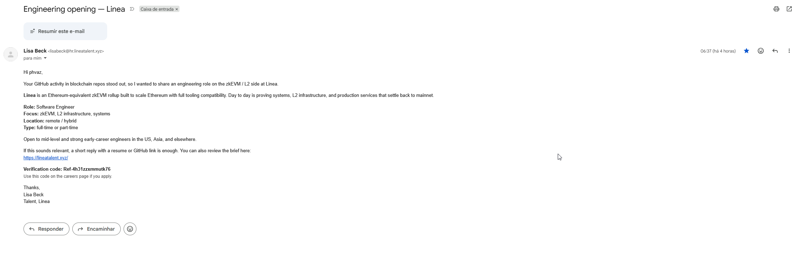

# Phase 01 — Initial Triage

## Objective

Record what actually arrived, preserve it, and state — before any deep analysis — *why* it warranted investigation rather than a one-click delete. Triage under **ISO/IEC 27037** is about identifying and securing the evidence while it is still in its original state; the interpretation comes later.

---

## The message as received

| Field | Value (as displayed) |
|---|---|
| From | **Lisa Beck** `<lisabeck@hr.lineatalent.xyz>` |
| To | `phvaz2001@gmail.com` |
| Reply-To | `lisabeck@hr.lineatalent.xyz` |
| Subject | Engineering opening — Linea |
| Date | 2026-10-05 09:37:43 UTC (06:37 local, BRT) |
| Call to action | Reply with a résumé / GitHub link, **or** visit `https://lineatalent.xyz/` and use verification code `Ref-4h31zzxmmutk76` |

**Body, in substance:** a short, well-written recruitment pitch. It opens with *"Your GitHub activity in blockchain repos stood out"*, describes a "Software Engineer — zkEVM / L2" role at Linea, states it is open to "mid-level and strong early-career engineers", and offers two low-friction next steps: a one-line reply, or the careers link with a verification code.

The full raw message is preserved at [`evidence/Engineering_opening_Linea.eml`](../evidence/Engineering_opening_Linea.eml).

---

## Preservation

| Action | Detail |
|---|---|
| Raw message exported | `.eml` downloaded directly from the mailbox, preserving all headers |
| Fixed by hash | SHA-256 `6c31f23c…30fa8e` (full value in [`collection-log.md`](../collection-log.md)) |
| Analysis copy | All subsequent work performed on the preserved file; the original mailbox item was later reported to the provider |
| Pixel safety | The message was read from raw source, so the embedded open-tracking image was never fetched (see [Phase 02](../phase02-header-analysis/README.md)) |

---

## Triage signals — why this was not dismissed as ordinary spam

Each signal below is an **observation** at this stage. It is only in later phases that these are confirmed against the raw evidence.

| # | Observed | Interpretation | Confidence |
|---|---|---|---|
| 1 | Sender domain is `hr.lineatalent.xyz`; the link is `lineatalent.xyz` | Not Linea's real domain, which is `linea.build`. A plausible-looking **lookalike** built around the "Linea" + "talent" theme. | High |
| 2 | The hook references the recipient's *GitHub activity in blockchain repos* | The lure is **tailored**, not generic. The recipient had recently published blockchain-investigation work publicly. This is targeting, not a broadcast. | Medium–High |
| 3 | Greeting reads "Hi **phvaz**" | "phvaz" is the local-part of the recipient's email address, not a real first name. Cheap automated personalisation — the operator does **not** actually know the recipient's name. | High |
| 4 | A "verification code" (`Ref-4h31zzxmmutk76`) to be used on the careers page | A legitimacy-and-urgency device: it manufactures a sense of a real, tracked application process and nudges the target onto the attacker's page. | Medium |
| 5 | Two low-friction CTAs: reply with a résumé/GitHub, or visit the page | Both paths serve the operator — a reply opens a conversation channel and confirms a live, responsive target; the page is the primary objective. | Medium |
| 6 | Unsolicited, inbound, high-opportunity ("remote, full or part-time, early-career welcome") | Classic recruitment-lure shape: attractive, broadly qualifying, and designed to make replying feel natural. | Medium |

---

## The single most important triage judgement

The recipient had, days before, **published blockchain-investigation work in public**. An unsolicited recruiter citing exactly that activity, from a domain that is not Linea's, is the textbook shape of a **recruitment-lure targeting a person because of their visible security/crypto profile**. That specific pattern — approaching researchers and engineers in the blockchain space through fake job offers — is a known and documented social-engineering vector (developed in [Phase 05](../phase05-attribution-correlation/README.md)).

That judgement set the posture for the whole case: **treat the message, the link, and anything the sender offers as hostile**, and investigate only through passive and sandboxed means.

---

## Triage outcome

| Item | Result |
|---|---|
| Classification at triage | Suspected targeted phishing / recruitment lure (impersonation of Linea) |
| Evidence preserved | Raw `.eml` + rendered screenshot, hashed |
| Engagement | None — no reply, no link, no code, no download |
| Decision | Proceed to full header analysis (Phase 02) on the preserved copy |

---

*Phase 01 — PHI-2026-001.*

**Next:** [Phase 02 — Email-Header Analysis](../phase02-header-analysis/README.md)
