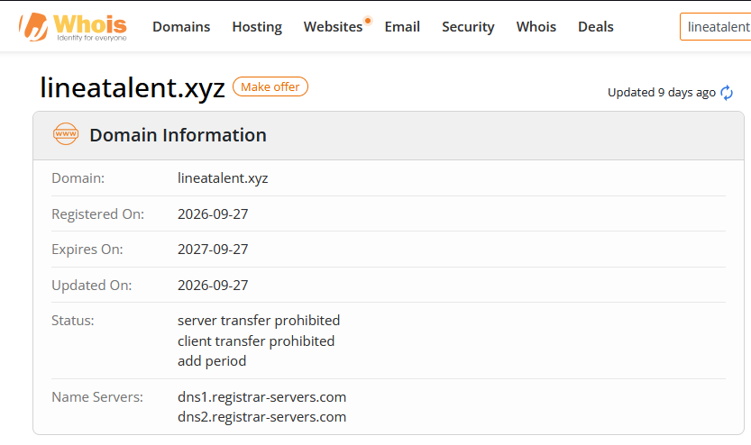
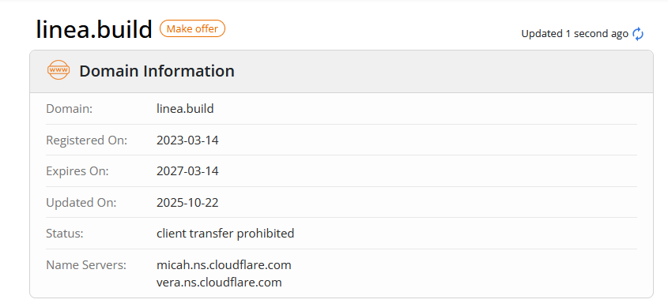
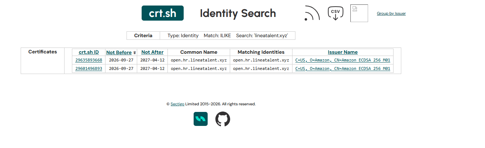

# Phase 03 — Domain & Infrastructure

## Objective

Establish the age, ownership signals and hosting of the lookalike domain, and contrast them with Linea's genuine domain. Domain registration and certificate data are among the most reliable OSINT signals available for a phishing case: they are timestamped, publicly logged, and — for Certificate Transparency — cryptographically append-only. Analysis and interpretation here follow **ISO/IEC 27042**.

---

## 3.1 — WHOIS comparison: lookalike vs genuine

**The lookalike — `lineatalent.xyz`:**

**The genuine Linea domain — `linea.build`:**

| Field | `lineatalent.xyz` (lookalike) | `linea.build` (genuine) |
|---|---|---|
| Registered on | **2026-09-27** | 2023-03-14 |
| Expires on | 2027-09-27 (1 year) | 2027-03-14 |
| Updated on | 2026-09-27 | 2025-10-22 |
| Registrar | Namecheap | (Cloudflare-managed) |
| Name servers | `dns1.registrar-servers.com`, `dns2.registrar-servers.com` (Namecheap default) | `micah.ns.cloudflare.com`, `vera.ns.cloudflare.com` |
| Domain status | `serverTransferProhibited`, `clientTransferProhibited`, **`addPeriod`** | `clientTransferProhibited` |

| Observed | Interpretation | Confidence |
|---|---|---|
| The lookalike was registered **2026-09-27 — 8 days before the email (2026-10-05)** | The domain was created specifically for this campaign and used almost immediately. Freshly-registered domains are a strong phishing indicator. | High |
| The genuine domain is **~3.5 years older** (2023-03-14) and renewed into 2027 | A real, established brand asset. The age gap alone cleanly separates the two. | High |
| Lookalike registered for the **minimum 1-year** term, on a **default Namecheap** nameserver set | A disposable, low-cost, single-purpose asset — the opposite of a brand that invests in its domain. | Medium–High |
| Status includes **`addPeriod`** | An ICANN registration-lifecycle flag present only in the first days after registration — independent corroboration that the domain was brand-new at the time of capture. | High |
| Genuine domain sits behind **Cloudflare** nameservers | Consistent with a real project's managed infrastructure; not a point of similarity the attacker tried to copy. | Low |

**On the name itself:** `lineatalent.xyz` is not a character-swap homoglyph of `linea.build` — it is a **plausible-sibling** lookalike. It reuses the real brand token ("linea") and bolts on a context word ("talent") under a cheap TLD (`.xyz`), producing a domain that reads as "Linea's talent/careers site" to someone not checking against `linea.build`. This is the more effective lookalike strategy against a target who knows the brand but not its exact domain.

---

## 3.2 — Certificate Transparency (crt.sh)

Certificate Transparency logs are append-only and cryptographically verifiable — an **authoritative relay** source. Query: identity search `lineatalent.xyz`.

| crt.sh ID | Common Name | Not Before | Not After | Issuer |
|---|---|---|---|---|
| 29635893668 | `open.hr.lineatalent.xyz` | 2026-09-27 | 2027-04-12 | Amazon ECDSA 256 M01 |
| 29601496893 | `open.hr.lineatalent.xyz` | 2026-09-27 | 2027-04-12 | Amazon ECDSA 256 M01 |

| Observed | Interpretation | Confidence |
|---|---|---|
| A publicly logged certificate exists for **`open.hr.lineatalent.xyz`**, issued by **Amazon**, **Not Before 2026-09-27** | Independent, cryptographic corroboration of the email headers: the tracking subdomain from Phase 02 is real and runs on **AWS infrastructure**. Two separate evidence layers (SMTP headers + CT log) now point to the same AWS-hosted tracking endpoint. **Convergence.** | High |
| The certificate's `Not Before` is the **same day the domain was registered** | Domain, DNS and TLS were all stood up on 2026-09-27 — a single-session build of a purpose-made campaign asset. | High |
| The **landing-page** certificate (issuer "YE2", see Phase 04) does **not** appear in this result; only the Amazon-issued tracking cert does | The email/tracking leg (AWS) and the web-hosting leg (a different provider/CA) are **separate infrastructure**. Recorded as an inference from an absence — the page cert may simply not have surfaced under this query — so held at **medium** confidence, but consistent with a compartmentalised setup. | Medium |

---

## 3.3 — Hosting and network (from urlscan, detailed in Phase 04)

| Attribute | Value |
|---|---|
| Landing-page IP | `193.160.32.10` |
| Geolocation | San Jose, United States |
| ASN / operator | AS206216 — **ADVIN-AS, Advin Services LLC** |
| Registrar (confirmed) | NAMECHEAP INC |
| Domain created (urlscan's own record) | 2026-09-27 00:30:34 UTC |

| Observed | Interpretation | Confidence |
|---|---|---|
| The page is served from **AS206216 (ADVIN-AS), San Jose**, while the email left from **AWS SES sa-east-1** | Confirms two distinct infrastructure legs: cloud email/tracking vs. web hosting on a small US hosting AS. Separation of function is a sign of a deliberately built operation. | Medium–High |
| urlscan's independently-recorded creation time (`2026-09-27 00:30:34 UTC`) matches the WHOIS and CT dates to the day | Three independent sources agree on the registration date — the "8 days old" finding is firmly established. | High |

---

## Phase 03 findings summary

| # | Finding | Confidence |
|---|---|---|
| 1 | `lineatalent.xyz` was registered **2026-09-27, 8 days before the lure** — a disposable, single-purpose domain | High |
| 2 | The genuine Linea domain `linea.build` is **~3.5 years older**; the two are cleanly separable on age and infrastructure | High |
| 3 | The lookalike is a **plausible-sibling** ("linea" + "talent" + cheap TLD), not a homoglyph | High |
| 4 | Certificate Transparency **independently corroborates** the AWS-hosted tracking subdomain from the headers, same-day as registration | High |
| 5 | Email/tracking (AWS) and web hosting (AS206216, San Jose) are **separate infrastructure legs** | Medium |

---

*Phase 03 — PHI-2026-001.*

**Next:** [Phase 04 — Landing-Page Analysis](../phase04-page-analysis/README.md)
