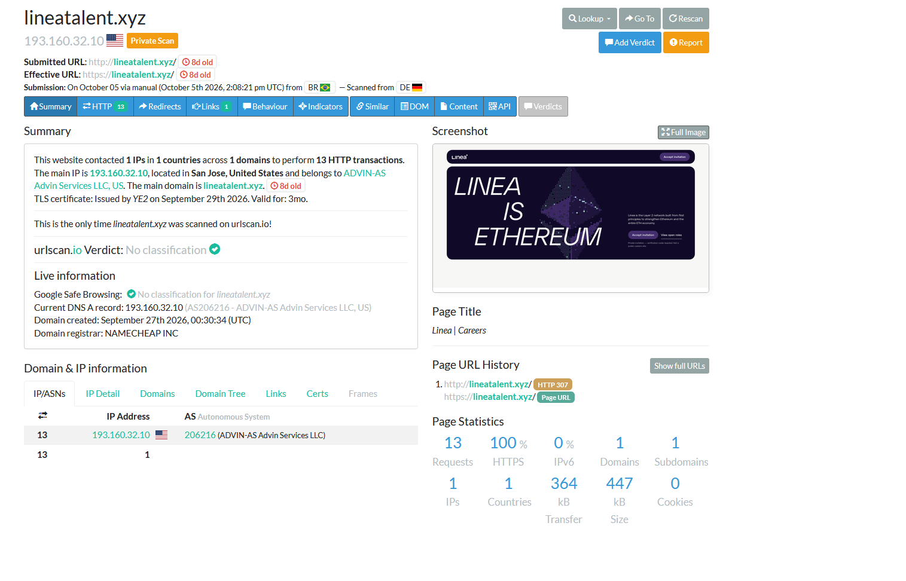

# Phase 04 — Landing-Page Analysis (Sandboxed)

## Objective

Determine what `https://lineatalent.xyz/` actually serves — **without ever visiting it directly**. The page is live, hostile infrastructure; the examiner's browser and network must never touch it. All observation is done through **urlscan.io**, which retrieves the page inside its own isolated environment and records what it saw. This respects the Phase 00 rule of engagement and keeps the analysis non-interactive, consistent with **ISO/IEC 27042**.

---

## 4.1 — The sandboxed scan

| Attribute | Value (urlscan, scan dated 2026-10-05) |
|---|---|
| Submitted URL | `http://lineatalent.xyz/` |
| Effective URL | `https://lineatalent.xyz/` (HTTP 307 → HTTPS) |
| Main IP | `193.160.32.10` |
| Location | San Jose, United States |
| ASN / operator | AS206216 — ADVIN-AS, Advin Services LLC |
| Domain registrar | NAMECHEAP INC |
| Domain created | 2026-09-27 00:30:34 UTC |
| TLS certificate | Issued by **"YE2"** on 2026-09-29, valid 3 months |
| Page title | **"Linea \| Careers"** |
| HTTP transactions | 13 requests, 1 IP, 1 domain, 0 subdomains contacted |
| Cookies | 0 |
| urlscan verdict | **No classification** |
| Google Safe Browsing | **No classification for `lineatalent.xyz`** |

---

## 4.2 — What the page is

The captured screenshot shows a dark, polished landing page headed **"LINEA IS ETHEREUM"**, styled to match Linea's real brand, with an **"Accept invitation"** call to action and "View open roles". The page title is **"Linea | Careers"**.

| Observed | Interpretation | Confidence |
|---|---|---|
| The page is a **brand-styled clone** presenting itself as "Linea | Careers" | A convincing impersonation front, consistent with the email's recruitment pretext. It exists to receive and convert the targets the email drives to it. | High |
| The primary CTA is **"Accept invitation"** plus the email's **"verification code"** mechanic | A scripted funnel: the email hands the target a code; the page asks them to "accept" and enter it. This converts a passive reader into an active participant and is the point where the next stage (credential capture, wallet connection, or a malicious "assignment"/download) would be delivered. The exact next stage was **not** exercised — doing so would mean engaging the attack. | Medium |
| Only **13 requests, 1 domain, 0 cookies** at the root | A lightweight front page; the harmful interaction is behind the CTA, not on initial load. Recorded as scope-limited: the analysis deliberately stops at the front page. | Medium |

> **Why the next step was not followed.** Clicking "Accept invitation" or submitting the code inside even a sandbox can trigger target-specific payloads and signals that the campaign is being analysed. The investigation's value here is in *characterising* the funnel from safe observation, not in walking into it. What the page is for is established; what it would have done next is left as a bounded inference.

---

## 4.3 — The reputation gap

| Observed | Interpretation | Confidence |
|---|---|---|
| Both **urlscan.io** and **Google Safe Browsing** returned **"No classification"** | The domain was too new to be catalogued as malicious at analysis time. **"Not classified" is not "safe"** — it reflects the detection lag between a domain going live and reputation systems flagging it. | High |
| The page's TLS cert was issued **2026-09-29**, two days after registration | Valid HTTPS and a padlock are trivial for an attacker to obtain and carry **no** trust signal. Users trained to "look for the padlock" are not protected here. | High |

This gap is the operational core of the whole campaign: a freshly-registered, properly-authenticated, HTTPS-secured, brand-cloned domain has a window — days to weeks — in which it passes every automated and visual trust check a non-expert would apply. The lure was sent **inside that window** (8 days after registration).

---

## 4.4 — The two infrastructure legs, side by side

| Function | Where | Evidence |
|---|---|---|
| Email delivery + open-tracking | Amazon SES `sa-east-1` + Resend; tracking subdomain `open.hr.lineatalent.xyz` on AWS | Headers (Phase 02) + CT log (Phase 03) |
| Web landing page | `193.160.32.10`, AS206216 ADVIN-AS, San Jose; cert issuer "YE2" | urlscan (this phase) |

Two providers, two certificate authorities, one domain tying them together. The operator separated the mail and web functions — a design choice that adds resilience (losing one leg does not immediately kill the other) and is characteristic of a planned operation rather than an opportunistic one.

---

## Phase 04 findings summary

| # | Finding | Confidence |
|---|---|---|
| 1 | `lineatalent.xyz` serves a **brand-cloned "Linea \| Careers"** page built to receive the lure's targets | High |
| 2 | The page funnels via **"Accept invitation" + verification code**; the next (harmful) stage was deliberately not exercised | Medium |
| 3 | Both urlscan and Google Safe Browsing had **not classified** the domain — detection lag, not safety | High |
| 4 | Valid HTTPS (cert issued 2026-09-29) provides **no** trust assurance for a fresh attack domain | High |
| 5 | The page sits on **separate hosting** (AS206216) from the AWS email/tracking leg | Medium–High |

---

*Phase 04 — PHI-2026-001.*

**Next:** [Phase 05 — Attribution & Pattern Correlation](../phase05-attribution-correlation/README.md)
